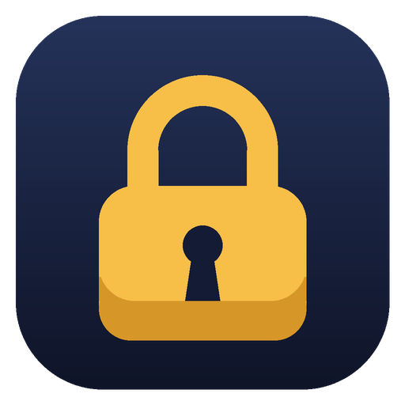
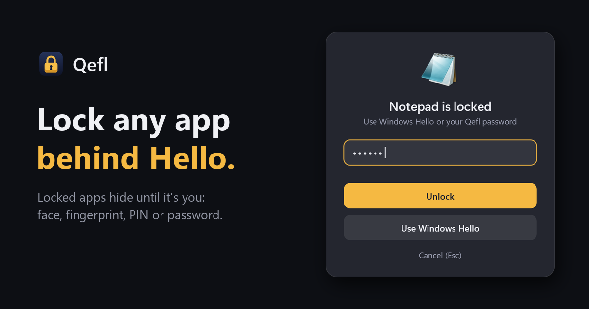

# Qefl · قفل

Lock any Windows app behind **Windows Hello** (face, fingerprint or PIN) or a password. When a locked
app comes to the front, its windows are hidden and a lock card asks for you; they come back as soon as
it's you. Lives in the tray, under 1 MB, no accounts and no network access.

- Lock apps from the tray: pick one that's open or choose a program.
- Lock again every time, 1 / 5 / 15 minutes or an hour after you leave, or when the app quits.
- Lock all now, and lock everything when the PC sleeps or the screen locks.
- Removing apps, changing settings and quitting ask for Windows Hello or the password first.
- A watchdog starts Qefl again if it's ended from Task Manager. Optionally locks Task Manager,
  Terminal, PowerShell and the other tools someone would use to stop it.

## Download

Get `Qefl-<version>-win-x64.zip` from the [latest release](https://github.com/mfathy234/qefl-releases/releases/latest),
unzip it somewhere permanent and run `qefl.exe`. Check the download against the `.sha256` file next to it.
If SmartScreen says *Windows protected your PC*, click **More info > Run anyway** (Qefl isn't code-signed yet).
Click the lock in the tray to choose apps. Windows 10 (1903) or 11, 64-bit.

Qefl is a privacy lock for people using your PC casually: it hides windows, it doesn't encrypt anything.
The password is stored only as a PBKDF2-SHA256 hash and the settings are encrypted for your Windows account.

Source is private. Licensed GPL-3.0-or-later (see [LICENSE](LICENSE)).
